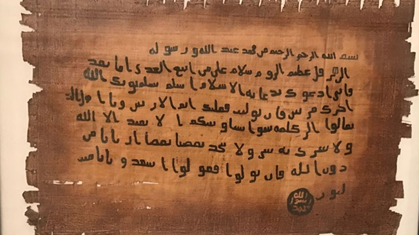
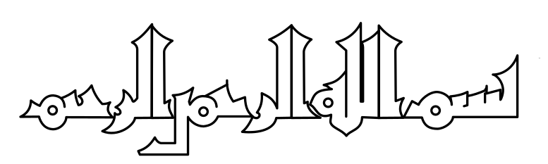
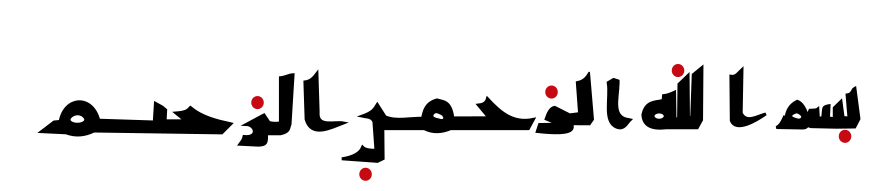
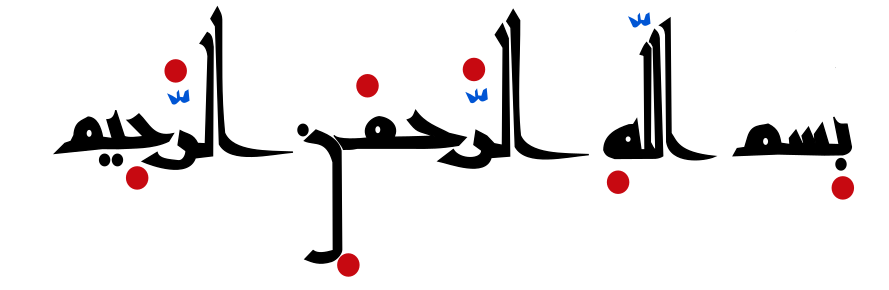
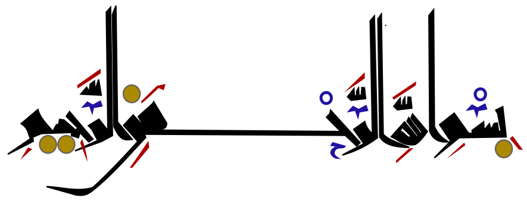
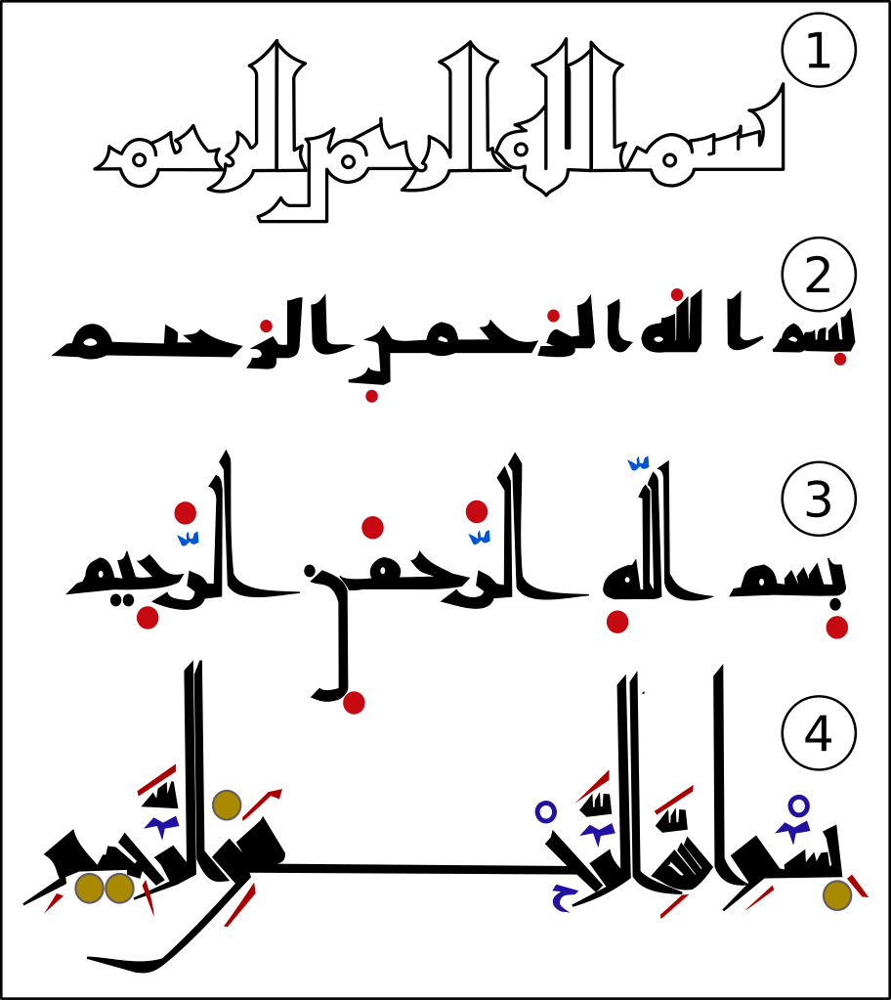

# تاريخ الخط العربي منذ ظهور الإسلام

Author: يوسف محمد

Published: 2024-11-01

Hijri date: 29 ربيع الثاني 1446هـ

منذ بداية الإسلام، اتخذ الخط العربي رحلة فريدة من نوعها، حيث تطور ليصبح أداة دقيقة للتعبير والكتابة. كان الهدف الأساسي من هذا التطور هو تسهيل قراءة القرآن وحمايته من أي خطأ أو لحن، مما أدى إلى إحداث تغييرات جذرية في كيفية كتابة الحروف وتحديد الحركات. بدأ الخط بلا نقط أو تشكيل، ثم تطور بفضل علماء عظام مثل **أبي الأسود الدؤلي** و**نصر بن عاصم** و**الخليل بن أحمد الفراهيدي**، ليصل إلى ما نعرفه اليوم.

### الخط العربي وقت الإسلام

كانت تُكتب العربية قديمًا دونَ نَقطٍ أو تشكيل.

_رسالة النبي إلى هرقل_

_بسم الله الرحمن الرحيم (البسملة) دون نقط_

مثلًا جملة: "ٮٮٮٮوا مں الحٮر" تَحتمِل جملتين:

إما "تبينوا مِن الخَبَر" وإما "تثبتوا مِن الحَبْر" (أي العالِم).
حسنًا كيف كان العربُ قديمًا يميزون بينهما؟
الإجابة ببساطة بالسليقة اللغوية وفهمهم للسياق. ومع دخول ألسنة غير عربية للإسلام وبَدْءِ اللحن في اللغة، لاحظ ذلك الإمام والصحابي الجليل **عليُّ بن أبي طالب** (رضي الله عنه)،
فوجَّه إلى تأسيس علم النحو وضبط العربية عالمًا من علماء المسلمين المخضرمين، وهو **أبو الأسود الدؤلي**.

---

### أبو الأسود الدؤلي (ت 69 هـ)

قد أسلم **أبو الأسود الدؤلي** ولكنه لم يرَ النبي ﷺ، وهو من ساداتِ التابعين وأعيانِهم وفقهائهم وشعرائهم.
وضع أبو الأسود نظامًا مبتكرًا لضبط قراءة المصحف، إذ قال لكاتبه: إذا وجدتني أضم شفتي بالحرف فضع نقطةً أمامه (أو إلى جواره).. وإذا وجدتني أفتح شفتيَّ بالحرف فضع نقطةً أعلاه.. وإذا وجدتني أكسر شفتيَّ بالحرف فضع نقطةً أسفله، وذلك بلونٍ يخالف لون المداد الأصلي (كالأحمر)، مثل الموضح في الصورة أدناه للبسملة!

وهذا يُسمى (نَقْط الإعراب) أي النقط الخاص بحركات النطق (الفتح والضم والكسر) الذي أصبح فيما بعد ( َ ُ ِ).. وقد بدأ لبيان حركات أواخر الكلمات ثم امتد لحركاتها.
تتلمذ على يد أبي الأسود الدؤلي كثيرون كان من أنبلهم **نصر بن عاصم الليثي** (ت 89 هـ).

---

### نصر بن عاصم الليثي (ت 89 هـ)

قد كان فقيهًا فصيحًا عالمًا بالعربية ويعدّ من علماء النحو المبرزين في زمانه حتى إنه نُسب إليه -بالخطأ- أنه مؤسس علم النحو والصواب أنه من أول من أخذ النحو عن أبي الأسود، وفتق فيه القياس.
إكمالًا لدرب شيخه في العناية بالعربية قنّن الليثي (بمشاركة **يحيى بن يعمر العدواني**) وعمّم في المصاحف طريقةً للتيسير أكثر على الأعاجم الداخلين للإسلام حديثًا، فقد وضع النقاط على الحروف لتمييز المتشابهات منها.

فمثلًا (ٮ) تُستخدم لثلاثة حروف (ب ت ث)

- وضع تحت الباء نقطة فأصبحت (ب)
- ووضع فوق التاء اثنتين فأصبحت (ت)
- ووضع فوق الثاء ثلاثًا فأصبحت (ث)
- وهكذا مع باقي الحروف المتشابهة الشكل
  مثل:
  ج ح خ - د ذ - ر ز - س ش - ص ض - ط ظ - ع غ - ف ق - ى ي
  وسُميت هذه الطريقة (نَقْط الإعجام).
  فأصبح عندنا نوعان للنقط:

1. **نقط الإعراب**: وهو النقط الدال على حركات الحرف من فتح وضم وكسر وتنوين، وتطور لاحقًا ليشمل ما يعرض للحرف من شد ومد وسكون (وكان يُرسم باللون الأحمر).
2. **نقط الإعجام**: وهو النقط الذي يدل على ذوات الحروف، ويميز معجمَها من مهملها، كالنقطة تحت الجيم ميَّزتها من الحاء، والنقطتين فوق التاء ميَّزتاها من الثاء (وكان يُرسم باللون الأسود كلون المداد الأصلي).

ولتجنب التباس كثرة النقاط بين نقط الإعراب ونقط الإعجام، استمر نَقْطُ الإعراب يُكتب باللون الأحمر ونقط الإعجام يُكتب باللون الأسود (كما بالصورة السابقة).
وكعادة هذه الأمة في تعلم العلم وتعليمه.. فقد تتلمذ على يد الليثي أيضًا علماء أجلاء نقلوا العلم وأضافوا له حتى جاء بعد عقود عالم من أهم العلماء ليس في عصره فقط بل في تاريخ اللغة العربية هو **الخليل بن أحمد الفراهيدي** (ت 170 هـ).

---

### الخليل بن أحمد الفراهيدي (ت 170 هـ)

قيل عنه: "كَانَ رَأْساً فِي لِسَانِ العَرَبِ".. و"صاحب العربية"، وهو مُنشئ علم العَروض وكتاب العين الذي يُعد أول معجم للعربية وهو أستاذ **سيبويه** في النحو.
الآن قد وصلنا للمرحلة الأخيرة التي تشكل نواة الكتابة العربية الحديثة (الكتابة التي نعرفها اليوم بالتشكيل) بعدما ظهر لَبسٌ بين نَقْط الإعراب (الذي باللون الأحمر) ونَقْط الإعجام (الذي باللون الأسود)..

استبدل التشكيلَ بنقطِ الإعراب.. فوضع:

الضمة ( ُ).. والفتحة ( َ).. والكسرة ( ِ).. والسكون ( ْ)..

ووضع أيضًا علامة الهمزة (ء).. وعلامة المد (آ).. والشدة ( ّ).

هذا غير العلوم التي لم يتحدث فيها أحدٌ قبله.. مثل عِلم العَروض وعلم الصوتيات.. فكان أول من تحدث عن مخارج الحروف في معجمه.. معجم العين.

---

### الخلاصة

مر الخط العربي بتطورات عديدة وكان الهدف الرئيسي دائمًا هو خدمة القرآن الكريم وحفظه من أي لَحنٍ أو خطأ في القراءة، فمنذ ظهور الإسلام تطور الخط على مراحل:

1. كانت الكتابة دون نقطٍ أو همزات أو تشكيل.
2. أضاف **أبو الأسود الدؤلي** إلى الخط ما يسمى **نَقط الإعراب** بلونٍ مخالف للون المداد (الأحمر).
3. ثم أكمل تلميذه **نصر بن عاصم الليثي** (بمشاركة **يحيى بن يعمر العدواني**) وقنّن **نَقط الإعجام** باللون الأسود ليفرق بين الحروف المتشابهة، مع بقاء نقط الإعراب باللون الأحمر.
4. ثم فك اللبس تمامًا بعدهما **الخليل بن أحمد الفراهيدي** ووضع التشكيل الذي نستخدمه إلى يومنا هذا.

