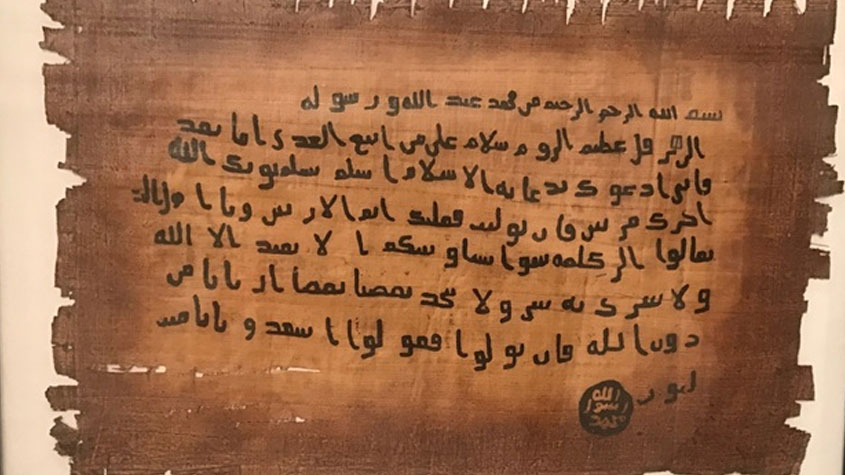
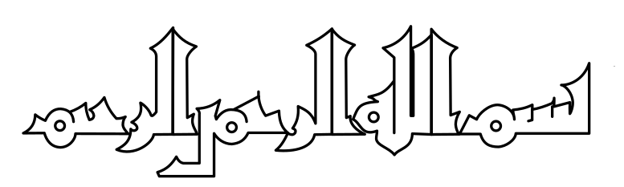
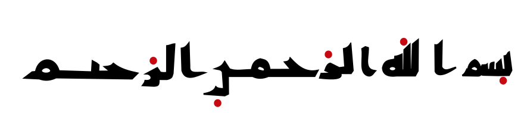
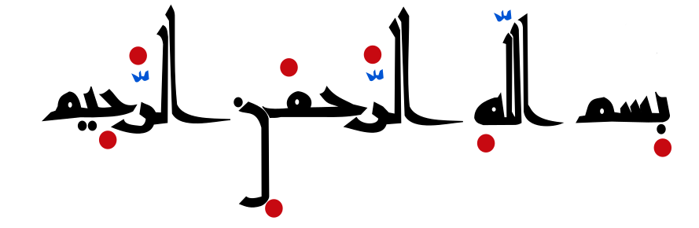
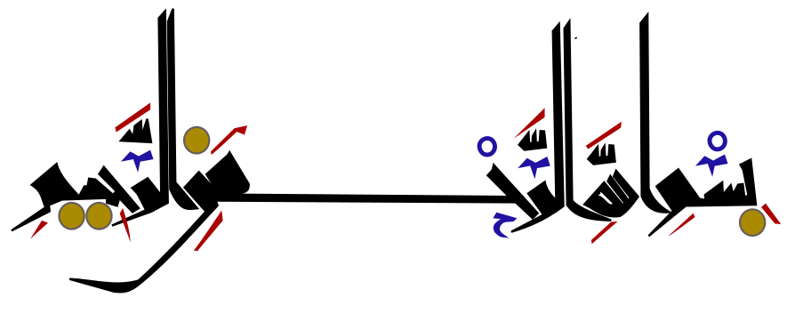
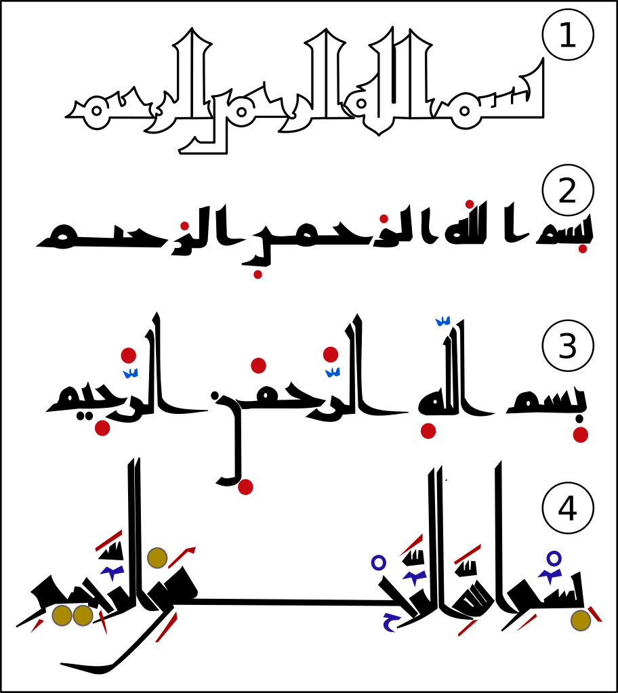

# معالجة النصوص العربية في JavaScript و Java بمكتبة arabic-services

Author: عبدالرحمن بيومي

Published: 2026-11-19

Hijri date: 9 جمادى الآخرة 1448هـ

عند بناء محرك بحث عربي، أو نظام فهرسة للمحتوى، أو أداة لتحليل النصوص، يواجه المبرمجون غالباً مجموعة من التحديات المتكررة: الكلمة التي بها تشكيل لا تطابق الكلمة التي بدون تشكيل في قاعدة البيانات، وعلامة التطويـــــل (الكشيدة `ـ`) تكسر مطابقة الكلمات، كما أن كتابة تعبيرات نمطية (Regex) سريعة غالباً ما تترك حالات استثنائية (`Edge Cases`) في النصوص العربية.

يوفر فريق **س - Seen** مكتبة **`arabic-services`** (خدمات اللغة العربية) مفتوحة المصدر بلغتي **JavaScript / TypeScript** و **Java** لمعالجة النصوص العربية بشكل مباشر ومختبر، مع إمكانية تجربة نفس الدوال مباشرة في المتصفح عبر صفحة [خدمات اللغة العربية](/Arabic-Services/).

### التثبيت السريع

#### في JavaScript و TypeScript (Node.js والمتصفح)

تعمل المكتبة بدون أي اعتماديات تشغيلية خارجية (`zero runtime dependencies`)، وتدعم ES Modules و CommonJS و UMD:

```bash
npm install arabic-services
```

وإذا أردت استخدامها مباشرة في المتصفح بدون أداة حزم (Bundler)، يمكنك تحميلها عبر CDN:

```html
<script src="https://cdn.jsdelivr.net/npm/arabic-services@1/dist/umd/arabic-services.umd.js"></script>
```

#### في Java (Maven و Gradle)

أضف التبعية التالية إلى ملف `pom.xml` في مشاريع Maven:

```xml
<dependency>
    <groupId>io.github.seen-arabic</groupId>
    <artifactId>arabic-services</artifactId>
    <version>1.0.1</version>
</dependency>
```

أو في `build.gradle` لمشاريع Gradle:

```groovy
implementation 'io.github.seen-arabic:arabic-services:1.0.1'
```

---

### أمثلة عملية لأهم الوظائف

#### 1. إزالة التشكيل (`removeTashkeel`)

تزيل هذه الدالة جميع حركات التشكيل (الفتحة، الضمة، الكسرة، الشدة، السكون، والتنوين) لتوحيد صيغة الكلمات قبل تخزينها أو البحث فيها.

في **JavaScript / TypeScript**:

```javascript
import { removeTashkeel } from 'arabic-services';

console.log(removeTashkeel('الخَيْلُ وَاللّيْلُ وَالبَيْداءُ تَعرِفُني'));
```

وفي **Java**:

```java
import io.github.seen_arabic.arabic_services.ArabicServices;

String result = ArabicServices.removeTashkeel("الخَيْلُ وَاللّيْلُ وَالبَيْداءُ تَعرِفُني");
```

> **الناتج:** الخيل والليل والبيداء تعرفني

#### 2. إزالة التطويـــــل (`removeTatweel`)

تنظّف النص العربي من علامة التطويل (الكشيدة `ـ`) حتى لا تعيق البحث أو مطابقة الكلمات.

في **JavaScript / TypeScript**:

```javascript
import { removeTatweel } from 'arabic-services';

console.log(removeTatweel('كن جميـــلا ترى الوجــود جميـــــلا'));
```

وفي **Java**:

```java
String result = ArabicServices.removeTatweel("كن جميـــلا ترى الوجــود جميـــــلا");
```

> **الناتج:** كن جميلا ترى الوجود جميلا

#### 3. التحويل إلى الرسم العربي القديم (`toOldArabic`)

تحول هذه الدالة النص العربي إلى صورته المجردة قبل وضع النقاط على الحروف، مع إزالة التشكيل والهمزات تلقائياً (ويمكنك قراءة الخلفية التاريخية لهذا التطور في مقال [تاريخ الخط العربي منذ ظهور الإسلام](/blog/arabic-script-history/)).

في **JavaScript**:

```javascript
import { toOldArabic } from 'arabic-services';

console.log(toOldArabic('الخَيْلُ وَاللّيْلُ وَالبَيْداءُ تَعرِفُني'));
```

وفي **Java**:

```java
String oldScript = ArabicServices.textToOldArabic("الخَيْلُ وَاللّيْلُ وَالبَيْداءُ تَعرِفُني");
```

> **الناتج:** الحىل واللىل والٮىدا ٮعرڡٮى

#### 4. التمويه البصري للنص الكامل (`tashfeer`)

تستبدل دالة `tashfeer` الحروف العربية بحروف ورموز مشابهة لها في الشكل بحيث يظل النص مقروءاً للعين البشرية:

```javascript
import { tashfeer } from 'arabic-services';

console.log(tashfeer('هذا النص مشفر'));
```

وفي **Java**:

```java
String obfuscated = ArabicServices.tashfeer("هذا النص مشفر");
```

> **مثال للمخرجات:** هـڏן اݪـڼص مشـڤـړ

#### 5. تشفير الكلمات المحظورة فقط (`tashfeerBannedWords`)

تعتمد هذه الدالة على قائمة كلمات محظورة شائعة؛ فإذا وُجدَت أي كلمة منها داخل الجملة تقوم بتمويهها وتشفيرها بصرياً فقط مع الإبقاء على بقية كلمات الجملة كما هي:

```javascript
import { tashfeerBannedWords } from 'arabic-services';

console.log(tashfeerBannedWords('جيش العدو يقتل الأطفال'));
```

وفي **Java**:

```java
String filtered = ArabicServices.tashfeerBannedWords("جيش العدو يقتل الأطفال");
```

> **مثال للمخرجات:** چـېـݭ ⴶلـݟـڊۅ يـٯـݖـڵ الأطفال

#### 6. تفكيك الكلمة إلى حروفها (`wordToLetters`)

تحوّل الكلمة العربية إلى أسماء حروفها المنطوقة بشكل واضح:

```javascript
import { wordToLetters } from 'arabic-services';

console.log(wordToLetters('شجرة'));
```

وفي **Java**:

```java
String letters = ArabicServices.wordToLetters("شجرة");
```

> **الناتج:** شين جيم راء تاء_مربوطة

#### 7. إزالة اللواحق العربية (`removeArabicAffixes`)

تقص السوابق واللواحق الشائعة (مثل "الـ" والتاء المربوطة) من الكلمة العربية للوصول إلى أصل أقرب، بالاعتماد على قواعد تقريبية وليس تحليلاً صرفياً كاملاً:

```javascript
import { removeArabicAffixes } from 'arabic-services';

console.log(removeArabicAffixes('المدرسة'));
```

وفي **Java**:

```java
String stem = ArabicServices.removeArabicAffixes("المدرسة");
```

> **الناتج:** مدرس

---

### جرّب الدوال الآن أو تصفّح الشيفرة المصدرية

- لتجربة كل هذه الوظائف مباشرة داخل المتصفح دون تثبيت: [خدمات اللغة العربية](/Arabic-Services/)
- مستودع JavaScript / TypeScript: [Arabic-Services-JavaScript](https://github.com/Seen-Arabic/Arabic-Services-JavaScript)
- مستودع Java: [Arabic-Services-Java](https://github.com/Seen-Arabic/Arabic-Services-Java)

---

# تاريخ الخط العربي منذ ظهور الإسلام

Author: يوسف محمد

Published: 2024-11-01

Hijri date: 29 ربيع الثاني 1446هـ

منذ بداية الإسلام، اتخذ الخط العربي رحلة فريدة من نوعها، حيث تطور ليصبح أداة دقيقة للتعبير والكتابة. كان الهدف الأساسي من هذا التطور هو تسهيل قراءة القرآن وحمايته من أي خطأ أو لحن، مما أدى إلى إحداث تغييرات جذرية في كيفية كتابة الحروف وتحديد الحركات. بدأ الخط بلا نقط أو تشكيل، ثم تطور بفضل علماء عظام مثل **أبي الأسود الدؤلي** و**نصر بن عاصم** و**الخليل بن أحمد الفراهيدي**، ليصل إلى ما نعرفه اليوم.

### الخط العربي وقت الإسلام

كانت تُكتب العربية قديمًا دونَ نَقطٍ أو تشكيل



_رسالة النبي إلى هرقل_



_بسم الله الرحمن الرحيم (البسملة) دون نقط_

مثلًا جملة: "ٮٮٮٮوا مں الحٮر" تَحتمِل جملتين:

إما "تبينوا مِن الخَبَر" وإما "تثبتوا مِن الحبر"
حسنًا كيف كان العربُ قديمًا يميزون بينهم؟
الإجابة ببساطة بالفطرة أو السليقة اللغوية بمعنى أدق وفهمهم للسياق. مع دخول ألسنة غير عربية للإسلام وبِدئ اللحن في اللغة.. لاحظ هذا الإمام والصحابي الجليل **عليُّ بن أبي طالب** (رضي الله عنه)
فوًّجه عالم من علماء المسلمين المخضرمين و مؤسس علم النحو وهو أبو الأسود الدؤلي

---

### أبي الأسود الدؤلي (ت 69 هـ)

قد أسلم أبي الأسود الدؤلي ولكنه لم يرَ النبي-ص-وهو من ساداتِ التابعين وأعيانِهم وفقهائهم وشعرائهم.
وَضَعَ أبو الأسود نظامًا مبتكرًا إذ قال لكاتبه إذا وجدتني أضم شفتي بالحرف فضع نقطةً إلى جواره.. وإذا وجدتني أفتح شفتيَّ بالحرف فضع نقطةً أعلاها.. وإذا وجدتني أكسر شفتيَّ بالحرف فضع نقطةً أسفله مثل الموضح في الصورة أدناه للبسملة !



وهذا يُسمى (نَقْط الإعراب) أي النقط الخاص بمخارج اللفظ (الضم والفتح والكسر) الذي أصبح في ما بعد ( َ ُ ِ).. إذ أنه يبين أواخر الكلمات (كما في صورة السابقة)
تتلمذ على يد أبي الأسود الدؤلي كثيرون كان من أنبلهم **نصر بن عاصم الليثي** (ت 89 هـ)

---

### نصر بن عاصم الليثي (ت 89 هـ)

قد كان فقيها فصيحاً عالماً بالعربية ويعدّ من علماء النحو المبرزين في زمانه حتى أنه نُسب إليه -بالخطأ- أنه مؤسس علم النحو والصواب أنه من أول من أخـذ النحو عن أبي الأسود، وفتق فيه القياس.
إكمالًا لدرب شيخه في العناية بالعربية ابتكر الليثي طريقة للتيسر أكثر على الأعاجم الداخلين للإسلام حديثًا فقد وضع النقاط فوق الحروف.. تلك النقاط التي تميز بين المتشابهات منها

فمثلًا (ٮ) تُستخدم لثلاثة حروف (ب ت ث)

- وضع تحت الباء نقطة فأصبحت (ب)
- ووضع فوق التاء إثنتين فأصبحت (ت)
- ووضع فوق الثاء ثلاث فأصبحت (ث)
- وهكذا مع باقي الحروف المتشابهة الشكل
  مثل:
  ج ح خ - د ذ - ر ز - س ش - ص ض - ط ظ - ع غ - ى ي
  وسُميت هذه الطريقة (نَقْط الإعجام)
  فأصبح عندنا نوعان للنقط



1. **نقط الإعراب**: وهو العلامات الدالة على ما يعرض للحرف من حركة أو شد أو مد أو سكون أو تنوين (باللون الأسود)..
2. **نقط الإعجام**: وهو النقط الذي يدل على ذوات الحروف، ويميز معجمَها من مهملها، كالنقطة تحت الجيم ميَّزتها من الحاء، والنقطتان فوق ت ميَّزتها من ث (باللون الأحمر).

لكن هنا ظَهرت مشكلة وهي كثرة النقاط وكيفية التمييز بين نقط الإعراب ونقط الإعجام؟ صار نَصُّ الإعراب يُكتب باللون الأحمر ونقط الإعجام يكتب باللون الأسود (كما بالصورة السابقة).
وكعادة هذه اﻷمة في تعلم العلم وتعليمه.. فقد تتلمذ على يد الليثي أيضًا علماء أجلاء نقلوا العلم وأضافوا له حتى جاء بعد بضعة عشر سنة عالم من أهم العلماء ليس في عصره فقط بل في تاريخ اللغة العربية هو **الخليل بن أحمد الفراهيدي** (ت 173هـ)

---

### الخليل بن أحمد الفراهيدي (ت 163 هـ)

يل عنه: "كَانَ رَأْساً فِي لِسَانِ العَرَبِ".. و" صاحب العربية،" وهو مُنشئ علم العَروض وكتاب العين الذي يُعد أول معجم للعربية وهو أستاذ **سيبويه** في النحو.
الآن قد وصلنا للمرحلة الأخيرة التي تشكل نواة الكتابة العربية الحديثة (الكتابة التي نعرفها اليوم بالتشكيل) بعدما ظهر لَبسٌ بين نَقْط الإعراب (الذي باللون الأحمر) ونَقْط الإعجام (الذي باللون الأسود)..

استبدل بنقط الإعجام التشكيل.. فوضع

الضمة ( ُ).. والفتحة ( َ).. والكسرة ( ِ).. والسكون ( ْ)..

ووضع أيضًا الهمزات (ء أ إ ئ ؤ).. وحرف المد (آ).. والشدة ( ّ)



هذا غير العلوم التي لم يتحدث فيها أحدٌ قبله.. مثل عِلم العَروض وعلم الصوتيات.. فكان أول من تحدث عن مخارج الحروف في معجمه.. معجم العين .

---

### الخلاصة

مر الخط العربي بتطورات عديدة وكان الهدف الرئيسي دائمًا هو خدمة القرآن الكريم وحفظه من أي لَحنٍ أو خطأ في القراءة فمنذ ظهور الإسلام تطور الخط على مراحل

1. كانت الكتابة دون نقطٍ أو همزات أو تشكيل
2. أضاف **أبو الأسود الدؤلي** إلى الخط ما يسمى **نَقط الإعراب**.
3. ثم أكمل تلميذه **نصر بن عاصم الليثي** بعده وأضاف **نَقط الإعجام** ليفرق بين الحروف المتشابهات واختار اللون الأحمر (لنقط الإعراب)واللون الأسود(لنقط الإعجام).
4. ثم فك اللبس تمامًا بعدهما **الخليل بن أحمد الفراهيدي** وأضاف التشكيل الذي نستخدمه إلى يومنا هذا


